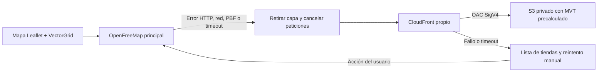

# Contingencia cartográfica en AWS

Estado al 2026-11-07: integración implementada y probada con fallos controlados.
**No se ha creado infraestructura AWS, publicado cartografía ni comprobado un endpoint real.**
La variable de respaldo está vacía por defecto. La aplicación continúa desplegada
según su configuración actual; esta propuesta no migra el backend ni la base de datos.

## Arquitectura y contrato



`mapProviders.ts` separa la configuración. `openFreeMap.ts` comparte fábrica,
renderer Canvas y estilos entre proveedores. `vectorTileTransport.ts` sustituye
únicamente el punto de extensión `_getVectorTilePromise` de VectorGrid 1.3.0.
`MapBaseLayer.tsx` controla selección, eventos, timers y limpieza.
`AssignedLocationsMap.tsx` conserva el mapa React, los marcadores, GPS, popups,
coordenadas, zoom y vista actual. El adaptador de coordenadas no cambia.

La inspección encontró que VectorGrid 1.3.0 devuelve una tesela vacía ante HTTP no
exitoso y no maneja rechazos de `fetch` en `createTile`. Escuchar `tileerror` por sí
solo no era suficiente. El transporte ahora verifica HTTP, captura red/lectura/PBF,
normaliza geometrías con los mismos decodificadores y emite un único `tileerror`.
`pbf@3.3.0` y `vector-tile@1.3.0`, ya presentes en el lockfile, se declaran directamente;
no se agrega una biblioteca nueva. Las promesas entregadas al renderer se resuelven
vacías después del fallo/cancelación para evitar rechazos sin capturar; el fallo ya
ha retirado la capa y no se comunica como éxito a la interfaz.

| Aspecto | Contrato |
| --- | --- |
| Formato | Mapbox Vector Tile/PBF, no PBF fuente de OSM, PNG, PMTiles ni MBTiles servido directamente |
| Rutas | HTTPS `https://<distribución>/lima/v1/{z}/{x}/{y}.pbf`; XYZ, norte como origen de Y |
| Zoom | Fuente completa 0–14; sobrezoom de Leaflet hasta 18, igual que antes |
| Capas visibles | `water`, `waterway`, `landcover`, `landuse`, `park`, `transportation` |
| Atributos relevantes | `transportation.class`: motorway, trunk, primary, secondary, tertiary |
| Estilos | Se conservan colores, opacidades y grosores actuales; no se descarga un style.json |
| Capas desactivadas | aeroway, boundary, building, housenumber, mountain_peak, place, poi, transportation_name, water_name |
| Otros recursos | Este renderer no necesita sprites ni fuentes externas: textos de tiendas vienen del DOM |
| HTTP | `Content-Type: application/x-protobuf`, `Content-Encoding: gzip`, caché versionada y CORS |

## Estados y límites de solicitudes

Cada montaje o reintento tiene una secuencia finita: principal → respaldo → error.
No se consulta AWS durante la carga normal del principal; no hay probes, polling,
prefetch de respaldo ni retorno automático al principal. El timeout por origen es
12 segundos y cubre también el import asíncrono de la capa. Un timeout de ambos
orígenes supone aproximadamente 24 segundos, más planificación del navegador.
`loading` vuelve a activar el timer al mover/zoomear un mapa que ya estaba listo;
`load` lo cancela, y `tileerror` retira la capa antes de iniciar la siguiente.
Un error tardío del principal también activa el respaldo.

Al retirar una capa se desconectan sus listeners, se elimina su timer y se abortan
sus solicitudes. Una capa creada después del timeout o desmontaje se descarta.
Solo existe una capa base instalada por intento. Un fallo puede coincidir con
varias solicitudes de tiles que Leaflet lanzó en paralelo; se cancelan, sin crear
una nueva ronda. Mover el mapa sí genera las peticiones normales del proveedor activo.

Cuando AWS carga se muestra un aviso y «Reintentar mapa principal». Si ambos fallan,
queda una lista con nombres, direcciones y enlaces de indicaciones, incluso sin
visitas disponibles. El botón de reintento comienza por OpenFreeMap. La lista se
construye con las ubicaciones autorizadas ya recibidas; **no es soporte offline**:
una recarga completa sin acceso a la API no garantiza recuperar datos. Los enlaces
de indicaciones también necesitan conectividad. No se persisten datos sensibles.

## Preparar un piloto de Lima

Hacerlo fuera del repositorio, en un equipo/entorno de generación independiente.
S3 solo almacena objetos: **no genera teselas ni sirve consultas dinámicas**.
No descargar en masa las teselas públicas de OpenFreeMap. El proceso propuesto usa
datos fuente OSM obtenidos legalmente y generación propia.

1. Revisar las licencias vigentes de todas las fuentes y del generador.
2. Usar Linux/WSL2, Git, Docker/Compose y GNU Make para el generador OpenMapTiles.
   No usar el PostgreSQL de la aplicación. Reservar disco y RAM conforme al dataset
   y medir antes de ampliar la región.
3. Clonar el generador en un directorio separado y fijar un commit revisado. Registrar
   su SHA, digests de imágenes, fechas, URL/checksum de fuentes, configuración y logs.
   Ejemplo Bash (los pasos siguientes no se ejecutaron durante esta implementación):

   ```bash
   git clone https://github.com/openmaptiles/openmaptiles.git omt-lima
   cd omt-lima
   git checkout <COMMIT_REVISADO>
   git rev-parse HEAD
   # Editar .env también: quickstart lo consulta para calcular/evitar el bbox automático.
   sed -i -e 's/^BBOX=.*/BBOX=-77.30,-12.40,-76.70,-11.70/' \
     -e 's/^MIN_ZOOM=.*/MIN_ZOOM=0/' -e 's/^MAX_ZOOM=.*/MAX_ZOOM=14/' \
     -e 's/^MBTILES_FILE=.*/MBTILES_FILE=lima.mbtiles/' .env
   export BBOX='-77.30,-12.40,-76.70,-11.70'
   export MIN_ZOOM=0
   export MAX_ZOOM=14
   ./quickstart.sh --empty south-america/peru geofabrik
   ```

   El quickstart importa el extracto de Perú y genera solo el bbox indicado. No
   reduce el costo de importar el extracto completo: para optimizarlo, preparar
   primero un extracto regional bien formado siguiendo la documentación del
   generador y conservando relaciones y geometrías costeras. Confirmar en el commit
   elegido que `BBOX`, `MIN_ZOOM` y `MAX_ZOOM` se respetaron en sus logs y metadatos.
   Identificar el `.mbtiles` resultante en `data/lima.mbtiles` y copiarlo al entorno
   de exportación. No usar el paquete Shortbread ofrecido por Geofabrik:
   su esquema de capas es diferente.

4. Asegurar que el MBTiles contiene zooms 0–14 y todas las capas de la tabla anterior.
   Incluir las fuentes auxiliares de agua/costa y cobertura del generador: omitirlas
   puede dejar en blanco el océano o la vegetación. Verificar diferencias visuales:
   compartir esquema y estilos no garantiza geometrías idénticas a OpenFreeMap.
5. Exportar una región interior con margen hasta el borde de los datos generados.
   Desde la raíz de National Facilities, ejemplo PowerShell:

   ```powershell
   python docs/maps/export_mbtiles.py C:/map-work/lima.mbtiles C:/map-work/lima-v1 --bbox -77.25 -12.35 -76.75 -11.75
   Set-Location frontend
   node scripts/validate-map-tiles.mjs C:/map-work/lima-v1
   ```

   Se convierte `tile_row` TMS de MBTiles mediante `y = 2^z - 1 - tile_row`.
   El exportador exige formato, esquema declarado, bounds y zoom compatibles;
   rechaza salidas existentes y limita a 20 000 objetos por defecto. Produce gzip
   determinista, un manifiesto con conteo/tamaño/hash y un PBF vacío válido para
   cada celda sin geometría dentro del piloto (los generadores pueden omitirlas).
   No se crean vacíos fuera del piloto. Una fuente incompleta también puede producir
   huecos: revisar el conteo de vacíos, datos por zoom y vista visual antes de publicar.
   El validador offline decodifica todos los tiles/geometrías, verifica conteos y
   exige agua y transporte reales. No prueba CORS ni disponibilidad de AWS.

6. Conservar junto a la versión los metadatos, manifiesto, procedencia, fecha del
   extracto y textos de atribución/licencia. No subir cartografía ni archivos
   grandes al repositorio Git. Mantener el material de generación necesario para
   cumplir las condiciones aplicables a bases de datos derivadas.

## Crear la infraestructura (requiere autorización del propietario)

Se entrega una plantilla CloudFormation independiente, porque el repositorio no
tiene Terraform, CDK ni otro sistema de IaC. Crea un bucket nuevo cifrado, con
bloqueo público y ownership del bucket, OAC firmado y distribución nueva. No usa
el endpoint web de S3. La política limita `GetObject` a esa distribución mediante
`AWS:SourceArn`. El bucket se retiene al eliminar la pila; **seguirá generando
costos hasta que el propietario lo elimine o gestione expresamente**.

Los tiles son datos públicos: CORS permite `*`, GET/HEAD y no permite credenciales.
CloudFront añade los encabezados con una Response Headers Policy después de la
caché; no necesita reenviar `Origin` para este caso de contenido invariable.
S3 tiene además CORS GET/HEAD, pero sigue siendo privado. El frontend no pide
preflight, no envía cookies ni cabeceras de autorización. Si en el futuro se
necesita un preflight con cabeceras personalizadas, configurar expresamente el
reenvío de Origin/Access-Control-Request-*; no está incluido en esta plantilla.
CORS no es autenticación ni evita que otros descarguen datos públicos.

No se reescriben 403/404 a `index.html` ni a 200. Los errores tienen caché de 10 s.
El cache key no incluye cookies, query strings ni headers. Los objetos se almacenan
ya comprimidos; `Compress=false` evita depender de la lista de MIME admitida por
la compresión automática y de variantes negociadas. Se sirve una única variante
gzip a navegadores compatibles; no soporta clientes que exijan `identity`.

Ejemplo AWS CLI v2, **solo para ejecutar después de autorización**, con un perfil
del propietario de pruebas configurado fuera del repositorio y con IAM mínimo:

```powershell
# Desde la raíz. Este proyecto no ejecutó ninguno de estos comandos AWS.
aws cloudformation validate-template --template-body file://docs/maps/aws-map-fallback.cloudformation.json --profile nf-sandbox
aws cloudformation deploy --template-file docs/maps/aws-map-fallback.cloudformation.json --stack-name nf-map-fallback-pilot --region us-east-1 --profile nf-sandbox --no-execute-changeset
# Revisar el change set y su costo. Ejecutarlo en consola solo con autorización.
# Después de crearse la pila y quedar CloudFront Deployed:
aws cloudformation describe-stacks --stack-name nf-map-fallback-pilot --region us-east-1 --profile nf-sandbox --query 'Stacks[0].Outputs'
```

La plantilla no crea roles IAM, dominios personalizados ni certificados ACM.
No es necesario permitir acceso al bucket desde el frontend. Revisar la política
del rol de publicación, los permisos para crear recursos y límites de la cuenta.
Los nombres/IDs devueltos son de esa instalación y no deben copiarse a Git.

## Publicar, comprobar y configurar

Reemplazar `<BUCKET_NUEVO>` y el dominio solo en el entorno privado del operador.
Publicar en un prefijo nuevo e inmutable; no mezclar versiones ni sobrescribir
objetos en caché. Primero revisar el `--dryrun`; después publicar autorizado:

```powershell
aws s3 cp C:/map-work/lima-v1/ s3://<BUCKET_NUEVO>/lima/v1/ --recursive --exclude '*' --include '*.pbf' --content-type application/x-protobuf --content-encoding gzip --cache-control 'public,max-age=31536000,immutable' --dryrun --profile nf-sandbox
# Tras revisar la lista, repetir sin --dryrun.
# El manifiesto NO es gzip ni una tesela: publicarlo por separado.
aws s3 cp C:/map-work/lima-v1/manifest.json s3://<BUCKET_NUEVO>/lima/v1/manifest.json --content-type application/json --cache-control 'public,max-age=3600' --profile nf-sandbox
```

Para una coordenada conocida del piloto, calcular XYZ con la función `tile_range`
del exportador o usar un archivo real de la salida. No suponer que un ejemplo de
z/x/y existe. Sustituir `<Z>/<X>/<Y>` en estas verificaciones:

```powershell
curl.exe --fail --head -H 'Origin: http://localhost:5173' 'https://<DOMINIO_CLOUDFRONT>/lima/v1/<Z>/<X>/<Y>.pbf'
curl.exe --fail --compressed --output C:/map-work/downloaded.pbf 'https://<DOMINIO_CLOUDFRONT>/lima/v1/<Z>/<X>/<Y>.pbf'
```

Verificar 200, MIME protobuf, `Content-Encoding: gzip`, `Cache-Control` esperado,
`Access-Control-Allow-Origin: *` y un ETag. Repetir para observar `Age`/`X-Cache`
y confirmar reutilización del caché. La segunda descarga debe ser PBF descomprimido
gracias a `--compressed`. Comparar con el contenido local descomprimido y decodificar
con Pbf/VectorTile; un 200 no demuestra que el cuerpo tenga el formato correcto.
S3 directo debe rechazar acceso anónimo. Una ruta inexistente debe devolver 403/404,
sin HTML con status 200. Confirmar también CORS en navegador desde el origen real:
curl no aplica la política CORS de un navegador.

En `frontend/.env.local` (no versionar):

```dotenv
VITE_AWS_MAP_TILES_URL=https://<DOMINIO_CLOUDFRONT>/lima/v1/{z}/{x}/{y}.pbf
```

Vite sustituye variables durante el build: reiniciar el dev server o reconstruir
la imagen/bundle. Cambiar variables del contenedor nginx ya construido no altera
el JavaScript. El Dockerfile admite:

```powershell
docker build --build-arg 'VITE_AWS_MAP_TILES_URL=https://<DOMINIO_CLOUDFRONT>/lima/v1/{z}/{x}/{y}.pbf' -t nf-frontend-map-pilot ./frontend
```

Endpoint vacío o inválido (HTTP, credenciales, query/hash, ruta incompatible)
deshabilita AWS y mantiene el comportamiento de principal → mensaje recuperable.
Si un CSP externo restringe `connect-src`, añadir expresamente el dominio CloudFront
en el entorno de pruebas. No se cambian las reglas de seguridad del backend.

## Verificación de contingencia real

1. Abrir el frontend de pruebas con datos ficticios, un usuario técnico autorizado
   y tiendas dentro del bbox. Con DevTools Network comprobar que el principal
   carga y que no se pide nada a CloudFront.
2. Desactivar caché del navegador, bloquear `tiles.openfreemap.org` en DevTools y
   pulsar reintento. Comprobar GET reales a CloudFront, CORS, PBF, aviso AWS,
   estilos, atribuciones y conservación de marcadores, vista, coordenadas y GPS.
3. Mover/zoomear y comprobar cargas nuevas; simular también una conexión que no
   responde para observar el timeout de 12 s, sin consultas periódicas.
4. Bloquear también el dominio CloudFront. Verificar el mensaje, lista con
   direcciones y enlaces, respuesta del resto de la aplicación y ausencia de
   nuevas rondas de solicitudes tras terminar el intento.
5. Desbloquear solo OpenFreeMap y pulsar reintento. Debe recuperar el principal,
   sin consultar AWS. Repetir desde un respaldo que funcionaba.
6. Navegar fuera del mapa durante cargas pendientes y verificar cancelación y
   ausencia de errores no capturados. Probar también una tienda fuera del piloto:
   puede faltar una tesela, y la lista debe seguir disponible.
7. Guardar evidencia fechada (HAR sin tokens, capturas, hashes de artefactos,
   dominio/versión privados, navegador y mediciones). Registrar explícitamente si
   los tiles vinieron de caché del navegador, CloudFront o S3.

Pruebas reproducibles sin API/backend ni AWS:

```powershell
Set-Location frontend
npm ci
npm test
npm run typecheck
npm run lint
npm run build
npm run test:map:e2e
# Si no existe Edge, instalar el navegador de Playwright y usar PW_CHANNEL=chromium.
# En CI se usa Chromium instalado por el workflow.
Set-Location ..
python -m unittest discover -s docs/maps -p test_export_mbtiles.py -v
```

La suite de mapas usa Leaflet/VectorGrid/Canvas reales y rutas HTTP interceptadas
con MVT sintético. Prueba HTTP 503, rechazo de red, PBF corrupto, timeout, carga
principal/respaldo, doble fallo y recuperación. **No verifica conexión real con
AWS ni calidad de la cartografía de Lima.** Las capturas versionadas corresponden
a ese escenario sintético. La suite E2E completa de negocio requiere la API y BD
indicadas en `docs/integration/setup-and-tests.md`; no se reemplaza ni elimina.

## Operación, costos y limitaciones

Medir antes de prometer un costo mensual. El manifiesto proporciona número de
objetos y bytes comprimidos de cada versión. Presupuestar almacenamiento S3
(incluyendo versiones retenidas), PUT de cada publicación, GET en cache miss,
solicitudes HTTPS y transferencia de CloudFront por región, generación de datos,
actualizaciones, logs/monitorización y posibles invalidaciones.

Ejemplo de dimensionamiento, **no cotización**: 100 aperturas/día × 20 teselas ×
30 días = 60 000 solicitudes/mes; a 30 KiB comprimidos por tile son aproximadamente
1.72 GiB de tráfico, más desplazamientos, zoom y reintentos. Multiplicar por las
tarifas vigentes de la cuenta/región; no asumir gratuidad ni créditos académicos.
`PriceClass_100` limita regiones de borde y puede aumentar latencia desde Lima;
evaluar `PriceClass_All` con el presupuesto antes de cambiarlo. El timer de 12 s
también debe validarse en dispositivos y redes móviles reales.

Crear presupuestos/alertas de facturación y observar CloudFront 4xx/5xx, hit ratio,
bytes, solicitudes, latencia y S3. Esta plantilla no instala alarmas ni un límite
duro de gasto. El origen privado no evita consumo público por terceros a través
de CloudFront; valorar controles adicionales si el volumen lo requiere.

Publicar una actualización mensual inicial (ajustar a la operación) en `lima/v2`,
validar completa y visualmente y cambiar la variable en un build de pruebas.
Retener una versión anterior para rollback y acordar con el propietario cuándo
eliminar datos antiguos/versiones S3. Evitar automatizar generación y publicación
sin límites, revisión y monitoreo. No se modifica `latest` en el frontend.

El piloto no cubre todo Perú. Desplazarse fuera de su cobertura produce errores
recuperables; no se limitan artificialmente los marcadores ni se cambian coordenadas
del negocio. Los estilos se mantienen, pero fechas, generalización y fuentes
auxiliares pueden producir diferencias respecto al principal. Un esquema compatible
no basta para acreditar equivalencia visual. El transporte usa una extensión
privada de VectorGrid: revisar este adaptador al actualizar la dependencia.

Para ISO/IEC 25010, las evidencias evalúan interoperabilidad de MVT/XYZ/HTTP,
tolerancia a fallos, recuperación manual y degradación de funcionalidad. No acreditan
por sí solas un SLA, disponibilidad medida, certificación ni operación offline.

## Fuentes y atribución

- [Formato y transporte de VectorGrid 1.3.0](https://github.com/Leaflet/Leaflet.VectorGrid/blob/v1.3.0/src/Leaflet.VectorGrid.Protobuf.js).
- [Esquema OpenMapTiles](https://openmaptiles.org/docs/schema/) y [generación propia](https://openmaptiles.org/docs/generate/generate-openmaptiles/).
- [Quickstart del generador](https://github.com/openmaptiles/openmaptiles/blob/master/quickstart.sh): fijar un commit antes de reproducir.
- [Extracto fuente de Perú de Geofabrik](https://download.geofabrik.de/south-america/peru.html).
- [Licencia y atribución de OpenStreetMap](https://www.openstreetmap.org/copyright): cumplir ODbL y las obligaciones aplicables al distribuir derivados.
- [Condiciones/documentación de OpenFreeMap](https://openfreemap.org/quick_start/): este procedimiento no espeja su servicio.
- [OAC para S3](https://docs.aws.amazon.com/AmazonCloudFront/latest/DeveloperGuide/private-content-restricting-access-to-s3.html), [headers de CloudFront](https://docs.aws.amazon.com/AmazonCloudFront/latest/DeveloperGuide/modifying-response-headers.html) y [compresión](https://docs.aws.amazon.com/AmazonCloudFront/latest/DeveloperGuide/ServingCompressedFiles.html).
- [Precios CloudFront](https://aws.amazon.com/cloudfront/pricing/) y [precios S3](https://aws.amazon.com/s3/pricing/): consultar al presupuestar, sin importes fijos asumidos aquí.
