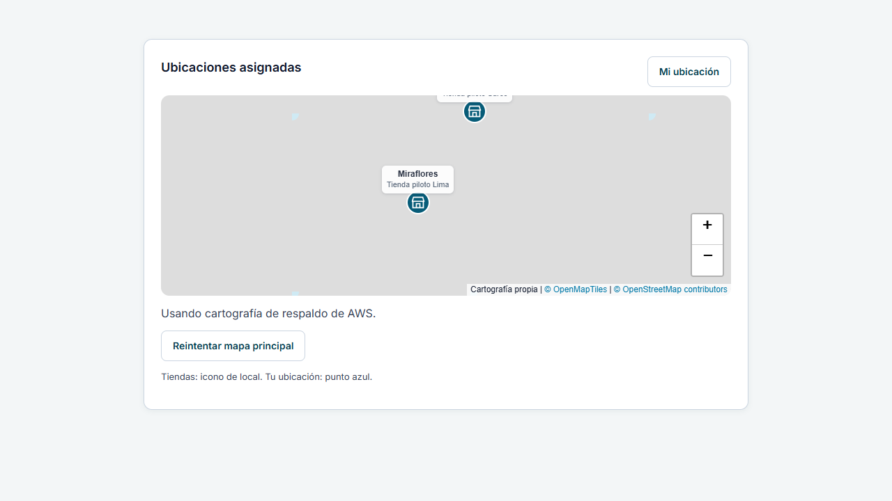
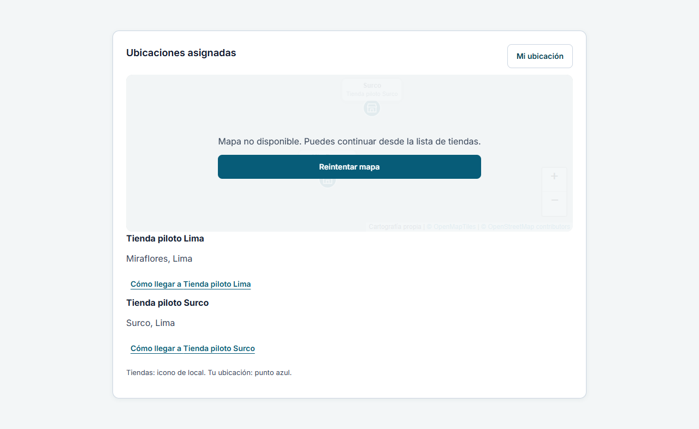

# Evidencia de implementación y pruebas

Fecha: 2026-11-07. Rama: `feat/aws-map-fallback`, creada desde
`origin/main` actualizado (`f2ab0835495463abb8a210f9aa4fa311b83c85bb`).
Entorno local: Windows, Node 22.14.0, npm 10.9.2, Python 3.13, Microsoft Edge.

## Resultados reales

| Comprobación | Resultado |
| --- | --- |
| `npm ci` | Correcto; versiones del lockfile existentes |
| `npm test` | 45 archivos, 300 pruebas aprobadas |
| `npm test -- src/features/technician` | 7 archivos, 51 pruebas aprobadas (incluye cámara y coordenadas existentes) |
| `npm run test:coverage` | 300 pruebas; umbrales existentes aprobados: statements 92.35%, branches 92.45%, functions 92.39%, lines 92.83% |
| `npm run test:map:e2e` | 6 pruebas aprobadas, Leaflet/VectorGrid/Canvas reales en Edge |
| `npm run typecheck` | Correcto, incluye las nuevas pruebas de navegador y su fixture |
| `npm run lint` | Correcto |
| `npm run format:check` | Correcto |
| `npm run build` y `npm run build:api` | Correctos |
| `node scripts/check-api-build.mjs` | Correcto; el bundle API no incluye fixtures/repositorio mock |
| `python -m unittest discover -s docs/maps -p test_export_mbtiles.py -v` | 6 pruebas aprobadas |
| Exportación y `validate-map-tiles.mjs` sobre MBTiles sintético | Correcto: 16 teselas, 15 vacías, agua y transporte decodificados |
| `python -m json.tool docs/maps/aws-map-fallback.cloudformation.json` | JSON válido localmente |
| `git diff --check` | Correcto |

La configuración de cobertura existente mide módulos centrales seleccionados;
**esos porcentajes no representan la cobertura del módulo cartográfico**.
Los escenarios cartográficos se verifican con sus pruebas específicas unitarias
y de navegador, conservando todas las pruebas anteriores.

Se corrigieron durante la validación errores de tipado/lint de las pruebas,
cierre de conexiones SQLite en Windows y actualización de la atribución:
React Leaflet no actualiza `prefix` automáticamente, por lo que se llama a
`setPrefix` sobre el mismo control sin remontarlo. Se elevó el overlay de carga/error
para que sus acciones no se solapen con los controles de Leaflet.

## Qué demuestran las pruebas

- OpenFreeMap correcto no crea una capa AWS ni hace peticiones a ese dominio.
- HTTP 403/404/429/500/503, error de red, cuerpo corrupto/ilegible y timeout se
  convierten en fallos recuperables; los errores de HTTP no son falsos éxitos.
- El principal fallido se retira y cancela antes de instalar el respaldo.
- La carga de AWS usa el mismo renderer y estilos; se actualizan aviso y atribución.
- Tras doble fallo no hay rondas automáticas adicionales; el reintento manual
  comienza por el principal, incluso desde un respaldo operativo simulado.
- Un nuevo ciclo `loading` después de estar listo también queda protegido por timeout.
- Eventos tardíos, imports tardíos, desmontaje y solicitudes concurrentes canceladas
  no reinstalan capas ni generan callbacks de estado sobre la vista desmontada.
- Los marcadores de tienda y GPS, coordenadas válidas, límites, controles y objeto
  de mapa se conservan. El fallo no vuelve a ejecutar `fitBounds`.
- Si no queda mapa base, nombres, direcciones e indicaciones siguen accesibles
  desde una lista independiente de visitas/checklists.
- El exportador convierte Y de TMS a XYZ, verifica contrato de la fuente,
  limita volumen, genera gzip determinista y evita sobrescribir salidas.

## Evidencia visual controlada

Estas capturas usan tiendas ficticias y teselas MVT sintéticas interceptadas por
Playwright. El fondo gris corresponde al fixture mínimo, **no a cartografía real de
Lima ni a un error de AWS**. Sirven para revisar estados, controles y marcadores.

## Pendientes y límites de esta verificación

- No se creó ni modificó ningún recurso AWS, ni se ejecutó un change set o despliegue.
- La plantilla pasó revisión local/JSON; queda pendiente validación semántica
  por CloudFormation en la cuenta autorizada, con IAM, cuotas y región reales.
- No se generó el dataset real de Lima ni se verificaron sus licencias auxiliares,
  cobertura, fidelidad visual, CORS, gzip y caché a través de un endpoint real.
- La suite E2E completa de negocio/backend no se ejecutó localmente: este entorno
  no tiene Django instalado ni API/BD de integración preparadas. Se mantuvo intacta
  y el workflow existente la seguirá ejecutando, además de la nueva suite de mapas.
- `npm ci` reportó 48 vulnerabilidades (34 moderadas, 14 altas) en el árbol existente.
  No se aplicó `audit fix` ni se actualizaron dependencias ajenas al alcance.
- No existe una tarea Jira suministrada para asociar; no se inventó un identificador.

El procedimiento para completar la habilitación y validación real, costos y riesgos
operativos está en [README](README.md).

## Archivos de la propuesta

Modificados:

- `.github/workflows/frontend.yml`
- `docs/decisions/README.md`
- `frontend/.env.example`
- `frontend/Dockerfile`
- `frontend/package.json`
- `frontend/package-lock.json`
- `frontend/tsconfig.app.json`
- `frontend/tsconfig.node.json`
- `frontend/src/features/technician/AssignedLocationsMap.tsx`
- `frontend/src/features/technician/AssignedLocationsMap.test.tsx`
- `frontend/src/features/technician/openFreeMap.ts`
- `frontend/src/features/technician/map.css`

Creados:

- `docs/decisions/011-contingencia-cartografica-aws.md`
- `docs/maps/README.md`
- `docs/maps/VERIFICATION.md`
- `docs/maps/aws-map-fallback.cloudformation.json`
- `docs/maps/export_mbtiles.py`
- `docs/maps/test_export_mbtiles.py`
- `docs/maps/screenshots/aws-fallback.png`
- `docs/maps/screenshots/both-failed.png`
- `frontend/playwright.map.config.ts`
- `frontend/map-tests/fixtures/map.html`
- `frontend/map-tests/fixtures/map.tsx`
- `frontend/map-tests/map-fallback.spec.ts`
- `frontend/scripts/validate-map-tiles.mjs`
- `frontend/src/features/technician/MapBaseLayer.tsx`
- `frontend/src/features/technician/MapBaseLayer.test.tsx`
- `frontend/src/features/technician/mapProviders.ts`
- `frontend/src/features/technician/mapProviders.test.ts`
- `frontend/src/features/technician/vectorTileTransport.ts`
- `frontend/src/features/technician/vectorTileTransport.test.ts`
- `frontend/src/features/technician/AssignedLocationsMap.fallback.test.tsx`
- `frontend/src/types/vector-tile.d.ts`
