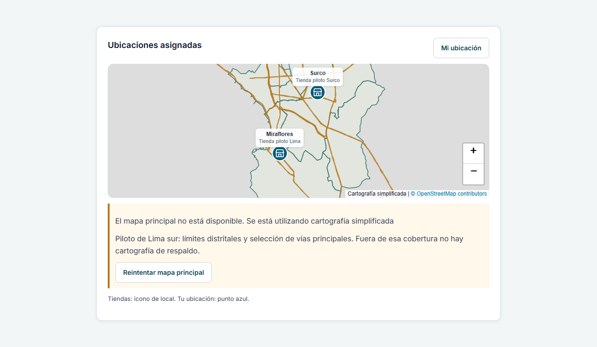
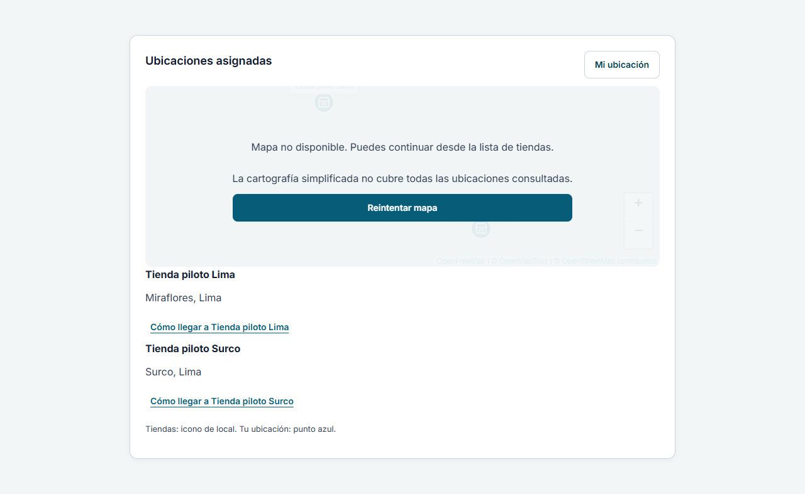

# Verificación — respaldo GeoJSON local

## Corrección de los tests de carga en CI (2026-11-07)

Las ejecuciones iniciales de GitHub Actions del commit `b347724` aprobaron
61 escenarios E2E y fallaron los dos de `e2e/loading.spec.ts`: la petición del
chunk del visor pasaba por el Service Worker y el `page.route()` del test no
la interceptaba. El artefacto móvil también registró una medición de contraste
durante la transición de cierre del menú.

Se bloquea el worker únicamente en ese archivo de tests, se espera el cierre
visual del menú antes de ejecutar Axe y se simula un MVT vacío válido para
comprobar la carga y el espacio reservado sin activar la contingencia. No se
eliminan aserciones de accesibilidad ni de dimensiones. La suite específica de
mapas conserva el Service Worker real y los escenarios de fallos del proveedor.

Verificación local de esta corrección, con Edge y backend/BD de prueba aislados
(PostgreSQL 18, `nf_integration`, puerto 55432):

- `npx playwright test e2e/loading.spec.ts`: **2 aprobadas**, 9,1 s.
- `npm run test:map:e2e`: **13 aprobadas**, 24,6 s.
- Lint, formato, TypeScript y build API: correctos.

Estos resultados locales no equivalen a una nueva ejecución completa de CI.
No se modifican componentes productivos ni la política de caché con esta corrección.

Fecha: 2026-11-07. Rama `feat/local-map-assets-cache`, sobre `c8fc65e`.
Inspección inicial: rama correcta y árbol limpio. No se modifica main, backend
o PostgreSQL; no hay merge ni despliegue. Sin dependencias nuevas.

## Resultados reales

| Comprobación | Resultado |
| --- | --- |
| `npm test` | 49 archivos, 336 pruebas aprobadas |
| `npm run test:map:e2e` | 13 escenarios aprobados con Edge, worker, Cache Storage, Leaflet y GeoJSON reales |
| `npm run lint` | Correcto |
| `npm run typecheck` | Correcto |
| `npm run format:check` | Correcto |
| `npm run build` | Correcto, emite GeoJSON con hash y worker |
| `npm run build:api` y `node scripts/check-api-build.mjs` | Correctos; el build API excluye fixtures y repositorio mock |
| SHA-256 del GeoJSON | `e80708c8900f84e56ade9625f222a2357c1ee8ace4254165ad00afd8818a1f22` |

Las pruebas de límite/capacidad y cancelación usan mocks y timers cuando corresponde.
Los escenarios de navegador usan el archivo GeoJSON OSM real versionado, pero las
respuestas de OpenFreeMap están interceptadas: no demuestran disponibilidad del
proveedor real. No se midió cobertura en esta ejecución y no se inventan porcentajes.

## Escenarios comprobados

- Principal correcto, sin solicitar GeoJSON.
- HTTP 503, error de red, PBF corrupto y timeout del principal activan GeoJSON.
- Capa principal retirada, marcadores conservados, tooltips/popups, zoom y atribución.
- Durante interacción local no se generan nuevas peticiones de teselas al principal.
- Archivo local ausente o corrupto y ubicaciones fuera del piloto terminan en lista.
- Cobertura mediante polígonos reales; rechazo de un punto de océano dentro del bbox,
  huecos/bordes con fixtures sintéticos aislados y coordenadas inválidas.
- Reintento manual vuelve al principal y desmonta GeoJSON; sin sondeos automáticos.
- GeoJSON guardado en Cache Storage y redibujado offline desde una vista cargada.
- Cambio de ubicaciones, import/carga tardíos, desmontaje, timeout local y error de capa.
- Lista accesible incluso ante fallo de importación del chunk del visor.
- Se conservan pruebas existentes del transporte, coordenadas, registro y política de caché.

Los datos del producto son reales; los polígonos sintéticos usados para comprobar
el algoritmo de huecos/bordes son solo fixtures de tests y no se distribuyen como
cartografía del piloto. Las tiendas de las capturas son ficticias.

## Evidencia visual

## Procedencia y límites

Datos OSM obtenidos una sola vez con Overpass y publicados bajo ODbL-1.0:
[procedencia, consulta, cobertura y reproducción](../../frontend/src/features/technician/data/README.md).
No se descargaron teselas de OpenFreeMap. No se crearon servicios de infraestructura.

No se certifican límites oficiales, exactitud topológica completa, calidad de un
callejero íntegro, rutas, disponibilidad nacional ni una PWA offline. La suite E2E
completa de negocio/API/BD se conserva en CI y no se ejecutó localmente. La política
de caché mantiene siete días/100 recursos/10 MiB; el navegador puede eliminarla.
